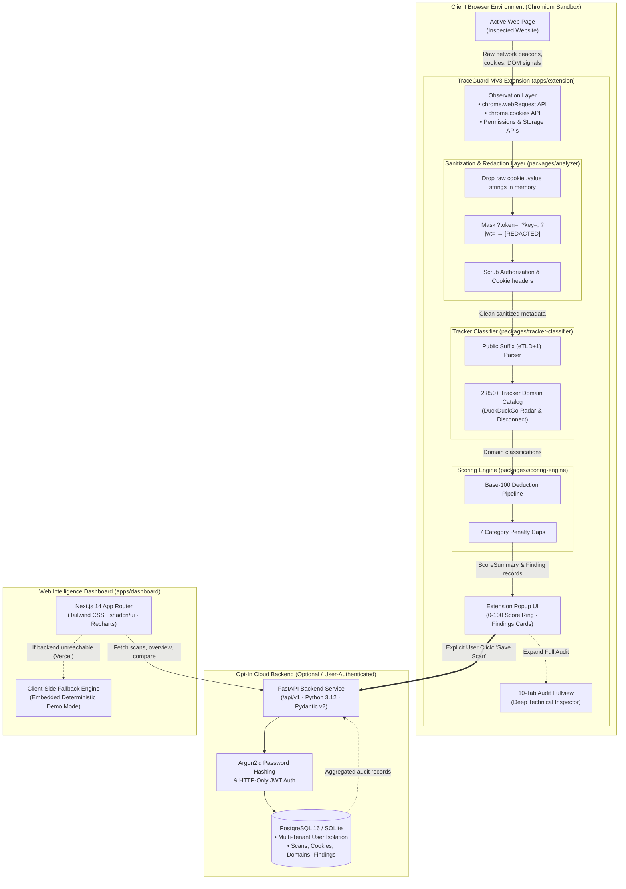
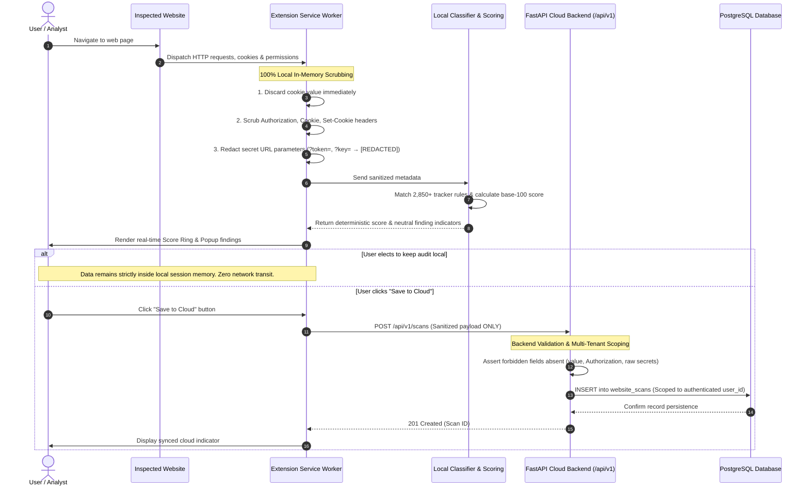
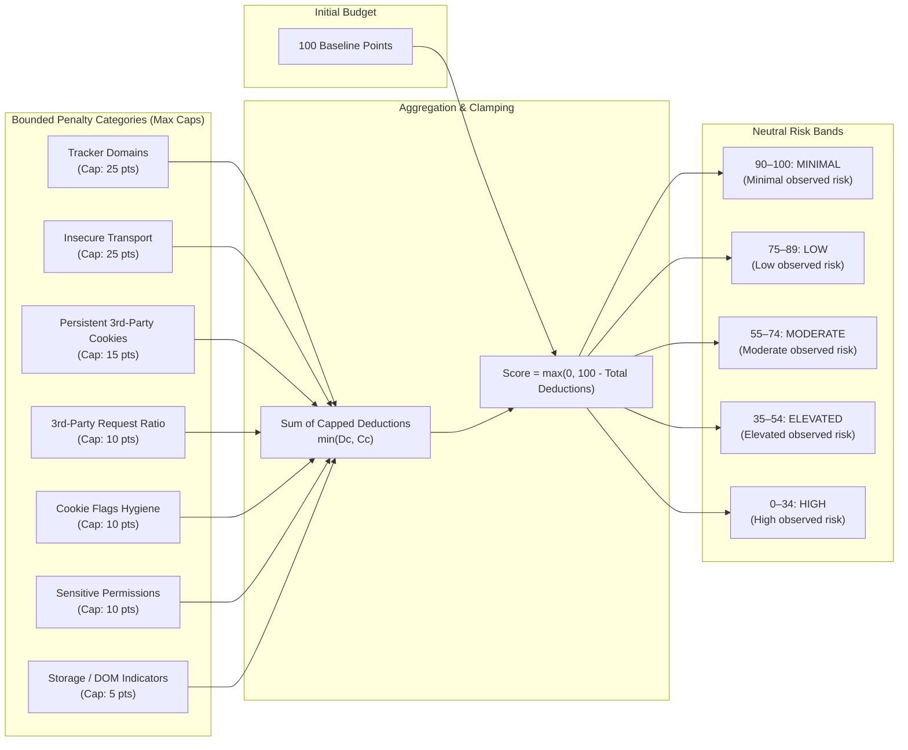

<div align="center">

# 🛡️ TraceGuard

### Web Privacy & Security Intelligence
**See what a website does behind the page.**

*TraceGuard turns complex browser privacy, network tracking, and storage signals into clear, actionable, neutral website intelligence.*

<br/>

[](https://tracegu4rd.vercel.app)
[](.github/workflows/ci.yml)
[](tests/)
[](tsconfig.base.json)
[](apps/api/)
[](apps/api/)
[](apps/dashboard/)
[](apps/extension/)
[](LICENSE)

<br/>

[**Explore Live Web App**](https://tracegu4rd.vercel.app) • [**Documentation**](docs/) • [**Scoring Model**](docs/scoring-model.md) • [**Privacy Architecture**](PRIVACY.md) • [**Security Policy**](SECURITY.md)

</div>

---

## ⚡ Executive Summary

TraceGuard is a defensive web privacy auditing tool designed to inspect third-party tracking, cookie hygiene, insecure transport, and device permission requests in real-time.

- **100% Local-First Interception**: All observation, eTLD+1 public suffix extraction, classification, and score calculations execute inside the browser sandbox.
- **Strict Privacy Guarantees**: Raw cookie `.value` strings, `Authorization` headers, and POST bodies are mathematically dropped in memory. Sensitive query parameters (`token`, `auth`, `key`, `secret`, `jwt`) are automatically masked to `[REDACTED]`.
- **Neutral Analytical Phrasing**: Follows strict objective reporting guidelines. TraceGuard **never** issues alarmist labels like `"MALICIOUS"`, `"SAFE"`, or `"UNSAFE"`. Observations are categorized under standardized risk bands (`MINIMAL`, `LOW`, `MODERATE`, `ELEVATED`, `HIGH`).
- **Dual-Layer Architecture**: A lightweight **Chrome Manifest V3 Extension** for immediate page audits, paired with a modern **Next.js 14 Dashboard & FastAPI Backend** for cross-site comparisons, historical analytics, and verifiable JSON/CSV reports.

---

## 🏗️ System Architecture



---

## 🔒 Privacy Redaction & Opt-In Save Lifecycle

TraceGuard guarantees that raw credentials or session values never touch storage or travel across the network.



---

## 📊 Deterministic Base-100 Scoring Model

Every inspected website starts with **100 baseline points**. Penalties are deducted across seven bounded categories, capped at a maximum of 100 total penalty points:

$$S = \max\left(0, 100 - \sum_{c=1}^{7} \min(D_c, C_c)\right)$$

Where $D_c$ represents total raw deductions calculated for category $c$, and $C_c$ represents the hard category cap.



### Penalty Category Caps & Deductions

| Category | Cap | Deductions Evaluated |
|---|:---:|---|
| **Classified Trackers** | **25 pts** | -18 Session Replay · -15 Fingerprinting · -10 Advertising · -5 Analytics |
| **Insecure Transport** | **25 pts** | -25 Plaintext HTTP origin · -10 Insecure mixed content resource |
| **Third-Party Persistent Cookies** | **15 pts** | -10 Cookie lifespan > 180 days · -5 Unpartitioned third-party cookie |
| **Third-Party Request Concentration**| **10 pts** | -10 Third-party request ratio > 60% · -5 Third-party request ratio > 35% |
| **Cookie Configuration Issues** | **10 pts** | -5 Missing `Secure` on HTTPS · -3 Missing `HttpOnly` on session cookies |
| **Privacy-Sensitive Permissions** | **10 pts** | -10 Geolocation / Camera / Microphone · -5 Push notifications prompt |
| **Storage & DOM Indicators** | **5 pts** | -5 More than 10 tracking identifier keys identified in localStorage |

---

## 🗂️ Monorepo Directory Layout

```text
TraceGuard/
├── apps/
│   ├── api/                        # FastAPI Python 3.12 Backend (/api/v1)
│   │   ├── app/
│   │   │   ├── core/               # Security, Argon2id, JWT auth, redaction rules
│   │   │   ├── db/                 # SQLAlchemy 2.0 async engine & session manager
│   │   │   ├── models/             # Relational ORM models (Users, Scans, Cookies, Domains)
│   │   │   ├── routers/            # Auth, Scans, Sites, Reports, and Settings endpoints
│   │   │   └── schemas/            # Pydantic v2 validation and output schemas
│   │   ├── Dockerfile              # Multi-stage non-root Python production container
│   │   └── requirements.txt        # Backend dependencies (FastAPI, SQLAlchemy, asyncpg)
│   ├── dashboard/                  # Next.js 14 Web Intelligence Dashboard (App Router)
│   │   ├── src/
│   │   │   ├── app/                # Landing, Login, Scans, Details, Compare, Analytics
│   │   │   ├── components/         # ScoreRing, CategoryChart, TrackerTable, UI primitives
│   │   │   └── lib/                # API client & Vercel deterministic fallback store
│   │   ├── Dockerfile              # Multi-stage Next.js standalone container
│   │   └── package.json            # Tailwind CSS, shadcn/ui, Recharts, Lucide
│   └── extension/                  # Chrome Manifest V3 Browser Extension
│       ├── src/
│       │   ├── background/         # Service worker, chrome.webRequest interception
│       │   ├── content/            # Isolated storage & DOM API probe
│       │   ├── popup/              # React 18 toolbar popup (ScoreRing, findings)
│       │   └── fullview/           # 10-tab technical deep-dive audit view
│       ├── manifest.json           # Manifest V3 configuration with strict permissions
│       └── vite.config.ts          # Vite multi-page Chrome extension build bundle
├── packages/
│   ├── analyzer/                   # eTLD+1 domain extraction & query redaction engine
│   ├── scoring-engine/             # Deterministic base-100 scoring algorithm & caps
│   ├── shared-types/               # Zod validation schemas & TypeScript contracts
│   ├── tracker-classifier/         # 2,850+ rule catalog (DuckDuckGo & Disconnect)
│   └── ui/                         # Design tokens, calm cybersecurity color system
├── database/
│   ├── migrations/                 # Alembic database migration revisions
│   └── seeds/                      # Deterministic demo seeder (demo@traceguard.local + 4 scans)
├── tests/
│   ├── api/                        # Pytest suite (Auth, Scans, Reports, Security Redaction)
│   ├── dashboard/                  # Vitest dashboard component & risk band calculation tests
│   ├── e2e/                        # Playwright E2E test suite (Full user journeys & export)
│   ├── extension/                  # Vitest extension tests (Sanitizer, classifier, domains)
│   └── scoring/                    # Vitest scoring engine boundary & penalty deduction tests
├── scripts/                        # Cross-platform runner scripts (Windows & POSIX)
├── .github/workflows/ci.yml        # GitHub Actions CI matrix (Lint, Tests, Builds, Docker)
├── docker-compose.yml              # Complete stack (Postgres 16 + FastAPI + Next.js)
├── Makefile                        # GNU Make developer entry points
├── README.md                       # Master product documentation
├── PRIVACY.md                      # Technical privacy model & redaction guarantees
└── SECURITY.md                     # Vulnerability disclosure & defensive boundaries
```

---

## 🚀 Quickstart & Installation

### Option 1: Live Web App (Zero Setup)

Experience TraceGuard immediately in your browser on Vercel:

👉 **[https://tracegu4rd.vercel.app](https://tracegu4rd.vercel.app)**

1. Navigate to **[https://tracegu4rd.vercel.app/login](https://tracegu4rd.vercel.app/login)**.
2. Click **"1-Click Evaluator Demo"** (or use `demo@traceguard.local` / `TraceGuardDemo!2026`).
3. Instantly explore seeded scans:
   - `news.example` (Score: 48 · Elevated Risk · 5 Trackers)
   - `shop.example` (Score: 68 · Moderate Risk · Session Replay)
   - `blog.example` (Score: 94 · Minimal Risk · Strictly Isolated)
   - `portal.example` (Score: 81 · Low Risk · Authenticated Session)
4. Test the **Side-by-Side Comparison tool**, **Analytics radar charts**, and **Export JSON / CSV reports**.

---

### Option 2: Install Chrome Extension (Local Unpacked)

1. Clone the repository and build the extension:
   ```bash
   git clone https://github.com/codename-harsh/TraceGuard.git
   cd TraceGuard
   pnpm install
   pnpm --filter @traceguard/extension build
   ```
2. Open Google Chrome or Brave and go to `chrome://extensions`.
3. Enable **Developer mode** (toggle in the top-right corner).
4. Click **Load unpacked** and select the folder:
   ```text
   TraceGuard/apps/extension/dist
   ```
5. Pin **TraceGuard** to your toolbar. Browse to any website to see real-time privacy signals.

*(Alternatively, download [`traceguard-extension-v1.0.0.zip`](traceguard-extension-v1.0.0.zip) from the repository root, unzip it, and load it into Chrome.)*

---

### Option 3: Full-Stack Local Development

Run the complete stack locally with live API synchronization:

#### Prerequisites
- Node.js `20.x`+ and `pnpm`
- Python `3.12`+ with virtual environment in `apps/api/.venv`

#### 1. Setup Backend Virtual Environment
```powershell
# Windows PowerShell:
python -m venv apps/api/.venv
apps/api/.venv/Scripts/python.exe -m pip install -r apps/api/requirements.txt

# Linux / macOS:
python3 -m venv apps/api/.venv
source apps/api/.venv/bin/activate
pip install -r apps/api/requirements.txt
```

#### 2. Run Database Migrations & Seed Demo Records
```bash
# Apply Alembic schema migrations
pnpm migrate

# Populate demo account with 4 sample audits
pnpm demo
```

#### 3. Start Development Servers
```bash
# Starts FastAPI (:8000) and Next.js (:3000) concurrently:
pnpm dev
```
- **Dashboard**: [http://localhost:3000](http://localhost:3000)
- **FastAPI OpenAPI Docs**: [http://127.0.0.1:8000/docs](http://127.0.0.1:8000/docs)
- **Backend Healthcheck**: [http://127.0.0.1:8000/health](http://127.0.0.1:8000/health)

---

### Option 4: Production Docker Stack

Deploy PostgreSQL 16, the FastAPI backend, and Next.js Web Dashboard via Docker Compose:

```bash
# Build and run containers in background
docker compose up -d --build

# View container logs
docker compose logs -f

# Stop containers
docker compose down
```

---

## 🧪 Testing & Quality Assurance

TraceGuard maintains rigorous automated verification across 162 total tests:

```bash
# 1. Run TypeScript Vitest suite (144 tests passing):
pnpm test

# 2. Run Python FastAPI Pytest suite (18 security & API tests passing):
pnpm test:api

# 3. Run complete unified test suite:
pnpm test:all

# 4. Monorepo TypeScript strict typecheck (0 errors across 8 packages):
pnpm typecheck

# 5. Production bundles build (Extension dist + Dashboard Next.js):
pnpm build

# 6. Playwright End-to-End Suite:
pnpm test:e2e
```

---

## 🛡️ Honest Technical Disclaimers

1. **Defensive Awareness**: TraceGuard is designed to observe and audit web telemetry. It is not an ad blocker or anti-virus tool; it does not tamper with or break page functionality.
2. **Client-Side Observability**: Analysis captures network and storage activity while the audited tab is active. Lazy-loaded scripts triggered later by complex user interaction may require continuous monitoring.
3. **No Ingestion of Server-Side Forwarding**: Direct server-to-server forwarding (such as Meta Conversions API or server-side Google Tag Manager) occurs entirely outside the browser environment and cannot be inspected client-side.
4. **No Legal Certification**: TraceGuard provides technical privacy auditing. It does not constitute formal legal certification for GDPR, CCPA/CPRA, or ePrivacy Directive compliance.

---

## 📄 License

This project is licensed under the [MIT License](LICENSE).
