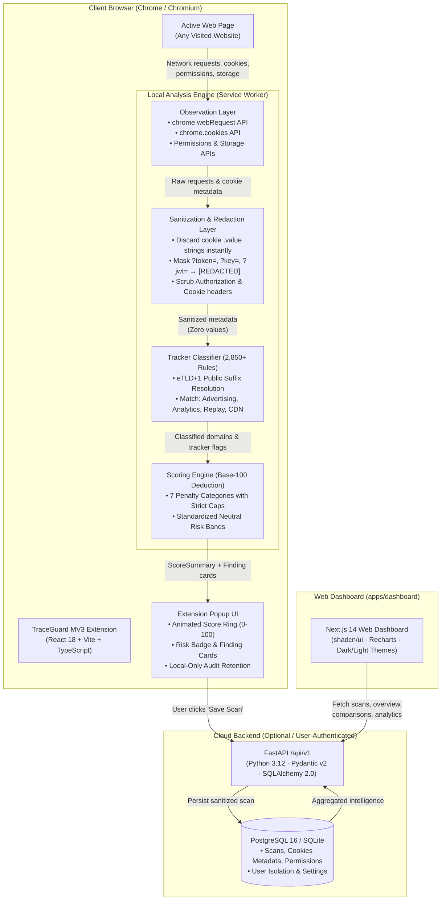

# TraceGuard

> **See what a website does behind the page.**
>
> *TraceGuard turns browser privacy and security signals into clear, transparent website intelligence.*

[](LICENSE)
[](tests/)
[](tests/api/)
[](tsconfig.base.json)
[](apps/api/)
[](apps/dashboard/)

---

## 1. System Architecture

TraceGuard operates as a **dual-layer, local-first intelligence engine**. By default, all network request interception, eTLD+1 domain extraction, tracker categorization, and score deductions execute **100% locally** in the Chrome MV3 Service Worker sandbox. Optional cloud synchronization to the FastAPI backend is strictly opt-in and triggered solely by explicit user action.



---

## 2. Core Feature Matrix

| Capability | Chrome Extension (Local) | Web Dashboard (Cloud-Synced) | Technical Guarantee |
|---|:---:|:---:|---|
| **Real-Time Request Auditing** | Yes | Historic | Captures third-party domains and unencrypted HTTP endpoints |
| **Tracker Classification** | Yes | Historic | 2,850+ domains categorized via DuckDuckGo Radar & Disconnect lists |
| **Cookie Hygiene Audit** | Yes | Historic | Inspects Secure, HttpOnly, SameSite, and persistence flags |
| **Cookie Value Redaction** | **Enforced** | **Enforced** | **Raw `.value` strings are mathematically dropped in memory** |
| **Secret URL Scrubbing** | **Enforced** | **Enforced** | Query keys (`token`, `auth`, `key`, `secret`, `jwt`) masked to `[REDACTED]` |
| **Site-by-Site Comparison** | No | Yes | Side-by-side Score Rings, tracker deltas, and category penalty charts |
| **Cross-Scan Analytics** | No | Yes | Prevalence matrix, tracker category distribution, cookie compliance rates |
| **Neutral Phrasing Model** | **Enforced** | **Enforced** | **Zero alarmist labels**; never uses "SAFE", "UNSAFE", or "MALICIOUS" |
| **Audit Reports Export** | No | Yes | Download comprehensive JSON & CSV audit reports with limitation disclaimers |

---

## 3. Monorepo Structure

TraceGuard is structured as a pnpm workspace monorepo:

```text
TraceGuard/
├── apps/
│   ├── api/                     # Python 3.12 FastAPI backend (/api/v1, SQLAlchemy 2.0, Pydantic v2)
│   ├── dashboard/               # Next.js 14 Web Dashboard (App Router, Recharts, Tailwind CSS)
│   └── extension/               # Chrome Manifest V3 Browser Extension (React 18, Vite, TypeScript)
├── packages/
│   ├── analyzer/                # eTLD+1 domain parsing, URL sanitizer, and query redactor
│   ├── scoring-engine/          # Deterministic base-100 weighted deduction scoring algorithm
│   ├── shared-types/            # Zod schemas and TypeScript interfaces shared across apps
│   ├── tracker-classifier/      # 2,850+ rule tracker catalog with category matching
│   └── ui/                      # Shared design tokens and Tailwind component foundations
├── database/
│   ├── migrations/              # Alembic database migrations (001_initial_schema.py)
│   └── seeds/                   # Deterministic demo seeder (demo@traceguard.local + 4 scans)
├── tests/
│   ├── api/                     # Pytest suite (auth, scans, sites, reports, security isolation)
│   ├── dashboard/               # Vitest component & calculation tests (bands, formatting, deltas)
│   ├── e2e/                     # Playwright E2E suite (journeys, demo mode, comparison, tabs)
│   ├── extension/               # Vitest unit tests (sanitizer, classifier, domain extraction)
│   └── scoring/                 # Vitest scoring engine boundary & penalty deduction tests
├── scripts/                     # Cross-platform helper scripts (Windows PowerShell & Unix)
├── docker-compose.yml           # PostgreSQL 16, FastAPI backend, and Next.js dashboard stack
├── Makefile                     # Root development commands
└── vitest.config.ts             # Workspace-wide Vitest configuration
```

---

## 4. Scoring Methodology & Standardized Risk Bands

TraceGuard evaluates websites on a deterministic **0 to 100** score scale. Every website starts with **100 baseline points**. Penalties are deducted across seven bounded categories, capped at a maximum of 100 total penalty points:

| Penalty Category | Max Cap | Description |
|---|:---:|---|
| **Classified Trackers** | 25 pts | Deducted based on tracker prevalence and categories (Session Replay, Advertising, Analytics) |
| **Insecure Transport** | 25 pts | Deducted for mixed HTTP content or unencrypted request endpoints |
| **Third-Party Persistent Cookies** | 15 pts | Deducted for tracking cookies set across third-party boundaries with long expiration |
| **Third-Party Request Concentration** | 10 pts | Deducted when more than 35% of total page requests cross the first-party boundary |
| **Cookie Configuration Issues** | 10 pts | Deducted for cookies missing `Secure` or `HttpOnly` flags |
| **Privacy-Sensitive Permissions** | 10 pts | Deducted for requesting Geolocation, Camera, Microphone, or Notifications |
| **Storage & DOM Indicators** | 5 pts | Deducted for extensive access to localStorage or sessionStorage tracking keys |
| **Total Possible Deduction** | **100 pts** | Minimum score is clamped at 0 |

### Standardized Risk Bands

Scores fall into standardized, neutral analytical risk bands as required by [`GEMINI.md`](GEMINI.md):

| Score Range | Risk Band | Official Phrasing |
|:---:|:---:|---|
| **90 – 100** | `MINIMAL` | Minimal observed risk |
| **75 – 89** | `LOW` | Low observed risk |
| **55 – 74** | `MODERATE` | Moderate observed risk |
| **35 – 54** | `ELEVATED` | Elevated observed risk |
| **0 – 34** | `HIGH` | High observed risk |

---

## 5. Quickstart & Installation Guide

### Prerequisites
- **Node.js**: `v20.0.0` or higher
- **pnpm**: `v9.0.0` or higher (`pnpm.cmd` on Windows PowerShell)
- **Python**: `v3.12` or higher (with virtual environment in `apps/api/.venv`)
- **Docker**: (Optional) Docker Desktop 24+ for containerized deployment

---

### Step 1: Clone and Install Dependencies

```bash
git clone https://github.com/traceguard/traceguard.git
cd TraceGuard

# Install monorepo Node dependencies
pnpm install
```

---

### Step 2: Setup Python Virtual Environment

```bash
# Windows PowerShell:
python -m venv apps/api/.venv
apps/api/.venv/Scripts/python.exe -m pip install --upgrade pip
apps/api/.venv/Scripts/python.exe -m pip install -r apps/api/requirements.txt

# Linux / macOS:
python3 -m venv apps/api/.venv
source apps/api/.venv/bin/activate
pip install -r apps/api/requirements.txt
```

---

### Step 3: Initialize Database & Seed Demo Data

TraceGuard includes a pre-configured database migration and seeding workflow:

```bash
# Apply Alembic schema migrations
pnpm migrate

# Populate Demo Mode evaluator account with 4 deterministic website audits:
pnpm demo
```

> **Demo Evaluator Account**:
> - **Email**: `demo@traceguard.local`
> - **Password**: `TraceGuardDemo!2026`
> - **Pre-seeded scans**: `news.example` (score 58), `shop.example` (score 88), `blog.example` (score 76), `portal.example` (score 28)

---

### Step 4: Run Development Servers

```bash
# Starts both FastAPI (:8000) and Next.js Dashboard (:3000) concurrently:
pnpm dev

# Or run components individually:
pnpm dev:api        # Starts FastAPI backend on http://localhost:8000
pnpm dev:dashboard  # Starts Next.js dashboard on http://localhost:3000
```

---

### Step 5: Install the Chrome Extension

1. Build the extension package:
   ```bash
   pnpm --filter @traceguard/extension build
   ```
2. Open Google Chrome or Chromium browser and navigate to `chrome://extensions`.
3. Enable **Developer mode** (toggle in the top-right corner).
4. Click **Load unpacked** and select the folder:
   ```text
   <your-repo-path>/apps/extension/dist
   ```
5. Pin the TraceGuard shield icon in your browser toolbar. Navigate to any website to observe real-time privacy signals.

---

## 6. Docker Container Deployment

Run the complete multi-container stack (PostgreSQL 16, FastAPI backend, Next.js web dashboard):

```bash
# Build and start all services
docker compose up -d --build

# View container logs
docker compose logs -f

# Shut down container stack
docker compose down
```

- **Dashboard**: `http://localhost:3000`
- **FastAPI Documentation**: `http://localhost:8000/docs`
- **Health Check**: `http://localhost:8000/health`

*(Note: The Chrome Extension runs inside client browsers and is not containerized.)*

---

## 7. Testing & Verification Suite

TraceGuard enforces 100% test passing gates across TypeScript and Python:

```bash
# 1. Run all TypeScript Vitest tests (144 passing):
pnpm test

# 2. Run backend FastAPI Pytest tests (18 passing):
pnpm test:api

# 3. Run complete test suites sequentially:
pnpm test:all

# 4. Run TypeScript compiler typecheck across all 8 workspace packages:
pnpm typecheck

# 5. Build production bundles for Extension and Dashboard:
pnpm build

# 6. Run Playwright End-to-End Suite:
pnpm test:e2e
```

---

## 8. Privacy & Security Boundaries

1. **Zero Cookie Value Transmission**: TraceGuard inspects cookie flags (`Secure`, `HttpOnly`, `SameSite`) and domain boundaries. The cookie `.value` string is never read, buffered, displayed, or transmitted.
2. **Credential & Secret Redaction**: Request headers containing `Authorization`, `Cookie`, or `Set-Cookie` are scrubbed. URL query parameters matching `token`, `auth`, `key`, `secret`, `password`, `session`, `code`, or `jwt` are replaced with `[REDACTED]`.
3. **No Request Body Interception**: Request payloads and POST bodies are never captured or logged.
4. **Tenant Isolation**: All database queries strictly scope scan records, findings, and preferences to the authenticated user ID.

---

## 9. Product Limitations

- **Client-Side Scope**: Observations are limited to network requests, cookies, and DOM indicators captured while the audited tab is active.
- **Server-Side Tracking**: TraceGuard cannot inspect backend log analytics or server-to-server forwarding (e.g., Meta Conversions API).
- **No Legal Compliance Certification**: TraceGuard is a technical auditing and security awareness tool; it does not provide legal guarantees regarding GDPR, CCPA/CPRA, or ePrivacy compliance.

---

## 10. License

TraceGuard is licensed under the [MIT License](LICENSE).
