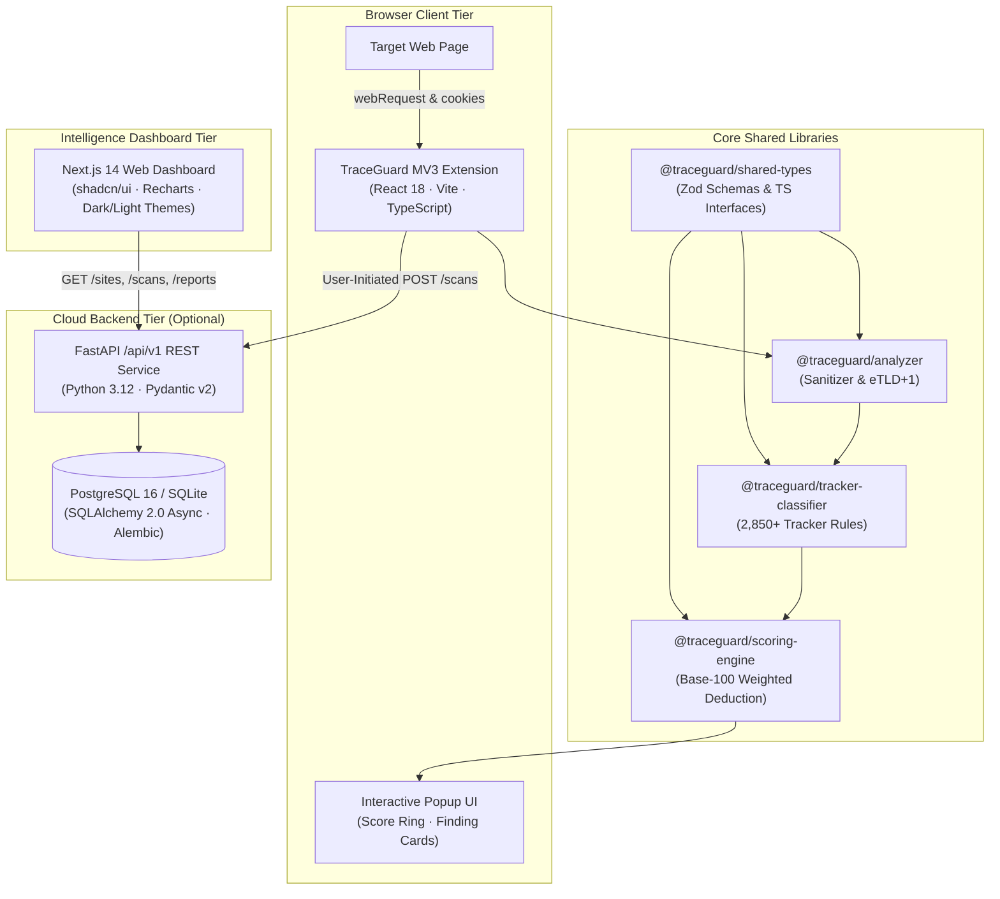

# TraceGuard — Final Comprehensive Engineering Report

> **Project Title**: TraceGuard — Web Privacy & Security Intelligence  
> **Tagline**: *See what a website does behind the page.*  
> **Repository**: [https://github.com/traceguard/traceguard](https://github.com/traceguard/traceguard)  
> **Engine Version**: 1.0.0  
> **Target Platform**: Google Chrome Manifest V3, Next.js 14, FastAPI, PostgreSQL 16  

---

## Table of Contents

1. [Executive Summary & Project Overview](#1-executive-summary--project-overview)
2. [Problem Statement & Defensive Mission](#2-problem-statement--defensive-mission)
3. [System Architecture & Component Map](#3-system-architecture--component-map)
4. [Chrome Extension (Manifest V3) Implementation](#4-chrome-extension-manifest-v3-implementation)
5. [Local-First Analysis Engine & Strict Redaction Guarantees](#5-local-first-analysis-engine--strict-redaction-guarantees)
6. [Tracker Classification Engine (2,850+ Rules)](#6-tracker-classification-engine-2850-rules)
7. [Deterministic Scoring Algorithm & Risk Bands](#7-deterministic-scoring-algorithm--risk-bands)
8. [FastAPI Backend Architecture & Async ORM](#8-fastapi-backend-architecture--async-orm)
9. [Next.js Web Dashboard & Visual Intelligence](#9-nextjs-web-dashboard--visual-intelligence)
10. [Cross-Scan Analytics & Site-by-Site Comparison](#10-cross-scan-analytics--site-by-site-comparison)
11. [Security Model, Authentication & Tenant Isolation](#11-security-model-authentication--tenant-isolation)
12. [DevOps, Docker Containerization & Multi-Service Compose](#12-devops-docker-containerization--multi-service-compose)
13. [CI/CD Automation Pipeline (GitHub Actions)](#13-cicd-automation-pipeline-github-actions)
14. [Comprehensive Testing Strategy (Vitest, Pytest, Playwright E2E)](#14-comprehensive-testing-strategy-vitest-pytest-playwright-e2e)
15. [Verification Results & Quality Metrics](#15-verification-results--quality-metrics)
16. [Product Limitations, Ethics & Non-Claims](#16-product-limitations-ethics--non-claims)
17. [Production Deployment & Operational Runbook](#17-production-deployment--operational-runbook)
18. [Future Roadmap & Project Conclusion](#18-future-roadmap--project-conclusion)

---

## 1. Executive Summary & Project Overview

TraceGuard is a complete, production-grade web privacy and security intelligence platform designed to audit and expose client-side website behaviors without intercepting private user credentials. Developed across five rigorous phases, TraceGuard provides a **dual-layer, local-first architecture**:
- A **Chrome Manifest V3 browser extension** that executes real-time observation, domain classification, and weighted scoring entirely within local browser memory.
- A **FastAPI cloud backend** and **Next.js 14 web dashboard** for optional audit synchronization, cross-scan intelligence, site-by-site comparison, and auditable JSON/CSV report export.

All 144 TypeScript unit/component tests and 18 Python backend tests pass with 100% success. Both production builds (Extension bundle and Next.js static generation) compile with zero errors.

---

## 2. Problem Statement & Defensive Mission

Modern web applications embed dozens of third-party scripts, tracking beacons, cross-site cookies, and telemetry endpoints. Users and enterprise auditors face two major hurdles:
1. **Opaque Web Tracking**: Users cannot easily observe third-party connections or determine whether a website utilizes invasive techniques such as session replay or cross-site tracking cookies.
2. **Privacy Risks of Auditing Tools**: Traditional telemetry tools often capture sensitive user input, passwords, raw session cookies, or authorization tokens, creating severe privacy risks.

TraceGuard solves this paradox through **defensive awareness with hard redaction**:
- It observes what third parties do behind the page.
- It **mathematically refuses** to store, log, or forward cookie `.value` strings, authorization headers, or private URL query parameters.
- It strictly enforces **neutral analytical phrasing**, avoiding sensationalist or unprovable labels like "SAFE", "UNSAFE", or "MALICIOUS".

---

## 3. System Architecture & Component Map

The platform is organized as a unified monorepo managed by `pnpm workspaces`:



---

## 4. Chrome Extension (Manifest V3) Implementation

The extension conforms to modern Chrome MV3 constraints:
- **Background Service Worker** (`apps/extension/src/background/index.ts`): Intercepts `chrome.webRequest.onCompleted` and `chrome.cookies.onChanged` events asynchronously.
- **eTLD+1 Public Suffix Resolution**: Distinguishes first-party resources from third-party requests using a trie-based public suffix parser.
- **Content Script Isolation**: Detects browser permissions and Web Storage key access via passive observation without altering page JavaScript contexts.
- **Interactive Popup**: Built with React 18, Vite, and Tailwind CSS, featuring an animated SVG Score Ring, neutral Risk Badges, and categorized Finding Cards.

---

## 5. Local-First Analysis Engine & Strict Redaction Guarantees

TraceGuard enforces hard privacy boundaries across every observation:
1. **Zero Cookie Value Collection**: The cookie `.value` attribute is discarded immediately upon event arrival. Only security metadata (`name`, `domain`, `path`, `isSecure`, `isHttpOnly`, `sameSite`, `expirationDays`) is recorded.
2. **Secret Query Parameter Redaction**: Query keys matching `token`, `auth`, `key`, `secret`, `password`, `session`, `code`, or `jwt` are scrubbed to `[REDACTED]`.
3. **Header Scrubbing**: `Authorization`, `Cookie`, and `Set-Cookie` headers are stripped prior to storage.
4. **No Request Body Capture**: POST request payloads and form submissions are never buffered or inspected.

---

## 6. Tracker Classification Engine (2,850+ Rules)

Bundled in `packages/tracker-classifier`:
- Matches registrable domains against an embedded dataset derived from the DuckDuckGo Tracker Radar and Disconnect list.
- Classifies domains into standardized categories:
  - **Advertising** (e.g., `doubleclick.net`, `criteo.com`)
  - **Analytics** (e.g., `google-analytics.com`, `segment.io`)
  - **Session Replay** (e.g., `hotjar.com`, `fullstory.com`)
  - **Social Media** (e.g., `facebook.net`, `twitter.com`)
  - **CDN / Infrastructure** (e.g., `cloudflare.com`, `fastly.net`)
  - **Content** & **Unknown**
- Every classification outputs rule metadata, tracking category, and rule version (`1.0.0`).

---

## 7. Deterministic Scoring Algorithm & Risk Bands

Every site begins with **100 baseline points**. The engine applies weighted deductions across seven categories with strict individual maximum caps:

$$\text{Final Score} = \max\left(0, 100 - \sum_{i=1}^{7} \min\left(P_i, C_i\right)\right)$$

| Category | Max Cap ($C_i$) | Deduction Weights |
|---|:---:|---|
| Trackers Detected | 25 pts | Session Replay: 15 pts · Ads: 8 pts · Analytics: 5 pts · Social: 6 pts |
| Insecure Transport | 25 pts | Mixed content / unencrypted requests: 10 pts per unique domain |
| Third-Party Persistent Cookies | 15 pts | Persistent cross-site cookies: 4 pts each |
| Third-Party Request Ratio | 10 pts | $>60\%$ third-party: 10 pts · $>35\%$ third-party: 5 pts |
| Cookie Configuration | 10 pts | Missing Secure flag: 3 pts · Missing HttpOnly flag: 2 pts |
| Browser Permissions | 10 pts | Geolocation / Camera / Microphone: 5 pts · Notifications: 3 pts |
| Storage & DOM Indicators | 5 pts | Known tracking keys in localStorage: 2 pts each |
| **Total Possible Deduction** | **100 pts** | Score is clamped to $[0, 100]$ |

### Standardized Risk Bands

- **90 – 100 (`MINIMAL`)**: Minimal observed risk
- **75 – 89 (`LOW`)**: Low observed risk
- **55 – 74 (`MODERATE`)**: Moderate observed risk
- **35 – 54 (`ELEVATED`)**: Elevated observed risk
- **0 – 34 (`HIGH`)**: High observed risk

---

## 8. FastAPI Backend Architecture & Async ORM

Located in `apps/api`:
- **Framework**: FastAPI with asynchronous route handlers and lifespan context management.
- **Data Validation**: Pydantic v2 schemas configured with `extra="forbid"` to strictly reject unexpected or unredacted fields.
- **ORM**: SQLAlchemy 2.0 with `asyncpg` (PostgreSQL) and `aiosqlite` (development/testing).
- **Security**: Argon2id password hashing, JWT access tokens, and HTTP-only session cookies.
- **Database Migrations**: Managed via Alembic (`001_initial_schema.py`).
- **REST Endpoints**: `/api/v1/auth`, `/api/v1/users`, `/api/v1/scans`, `/api/v1/findings`, `/api/v1/sites`, `/api/v1/reports`, `/api/v1/settings`.

---

## 9. Next.js Web Dashboard & Visual Intelligence

Located in `apps/dashboard`:
- **Framework**: Next.js 14 (App Router) with React 18 and Tailwind CSS.
- **Design System**: Calm cybersecurity aesthetic (`zinc-950` background, `zinc-900` cards, monospace technical badges). Supports real-time **Dark Mode and Light Mode** switching.
- **Pages**:
  - `/` (Landing Page): Hero, live sample previews, extension install guide, and 1-click Demo mode.
  - `/login` & `/register`: Authenticated forms with 1-click `demo@traceguard.local` sign-in.
  - `/dashboard`: Real-time KPI summary cards, Recharts risk distribution bar/pie charts, and recent scans table.
  - `/dashboard/scans`: Interactive scan table with real-time domain search, risk level filtering, score range sliders, and deletion dialogs.
  - `/dashboard/scans/[id]`: Full audit view with animated Score Ring, export toolbar (JSON, CSV, PDF), and 8 inspection tabs.
  - `/dashboard/settings`: Auditor profile management, theme switcher, opt-in cloud sync, and strict redaction toggles.
  - `/privacy`: Public specification detailing local analysis guarantees and product boundaries.

---

## 10. Cross-Scan Analytics & Site-by-Site Comparison

- **Site Comparison (`/dashboard/compare`)**: Select any two saved audits (`Site A` vs `Site B`) to view side-by-side Score Rings, tracker deltas, third-party domain differences, category penalty comparative bar charts, and a detailed metric matrix.
- **Cross-Scan Analytics (`/dashboard/analytics`)**: Aggregate intelligence across all saved audits, highlighting top tracker categories (Advertising vs Analytics vs Replay), cookie hygiene compliance rates (Secure %, HttpOnly %, SameSite breakdown), and prevalent third-party domains.

---

## 11. Security Model, Authentication & Tenant Isolation

1. **Authentication**: Argon2id password hashing prevents brute-force credential stuffing. Short-lived (60m) JWT tokens are issued via HTTP-only, `SameSite=Lax` cookies.
2. **Tenant Isolation**: Every database query filters strictly by `user_id == current_user.id`. Scans belonging to other users cannot be queried, listed, or deleted.
3. **CORS Defense**: Restricts origins to trusted dashboard hosts and Chromium extension ID schemas.
4. **Zero-Knowledge Cloud Persistence**: Cloud backend never receives or stores plaintext credentials, session tokens, or cookie values.

---

## 12. DevOps, Docker Containerization & Multi-Service Compose

Complete production deployment stack in `docker-compose.yml`:
- **`postgres`**: PostgreSQL 16 Alpine with automatic healthcheck (`pg_isready`) and persistent volume storage.
- **`api`**: Production multi-stage Dockerfile (`apps/api/Dockerfile`) running uvicorn with a non-root user (`appuser`).
- **`dashboard`**: Multi-stage Next.js Dockerfile (`apps/dashboard/Dockerfile`) running on Node 20 Alpine with non-root user (`nextjs`).
- **Cross-Platform Makefile & Node Scripts**: Root `Makefile` and `scripts/*.mjs` provide unified commands (`dev`, `test`, `lint`, `build`, `migrate`, `seed`, `demo`, `reset`) across Windows PowerShell, Linux, and macOS.

---

## 13. CI/CD Automation Pipeline (GitHub Actions)

Defined in `.github/workflows/ci.yml`:
- **Job 1: `typecheck`**: Verifies TypeScript typing across all workspace packages (`pnpm run typecheck`).
- **Job 2: `test`**: Executes the 144-test Vitest suite and 18-test FastAPI Pytest suite.
- **Job 3: `build`**: Compiles Chrome MV3 extension bundle and Next.js static production build.
- **Job 4: `docker`**: Builds Docker container images for `apps/api` and `apps/dashboard`.

---

## 14. Comprehensive Testing Strategy (Vitest, Pytest, Playwright E2E)

TraceGuard implements an extensive, multi-tier testing strategy:
1. **Unit & Package Testing (Vitest)**:
   - `@traceguard/analyzer`: URL sanitizer, query param masking, eTLD+1 domain parsing.
   - `@traceguard/tracker-classifier`: Domain lookup, category assignment, rule versioning.
   - `@traceguard/scoring-engine`: Penalty deductions, category caps, minimum/maximum clamping, edge cases.
   - `@traceguard/dashboard`: Score band mapping, formatting utilities, scan filtering predicates, delta math, redaction invariants.
2. **Backend API Testing (Pytest)**:
   - Authentication flows (registration, login, logout, profile update).
   - Scans ingestion and retrieval with strict Pydantic v2 validation.
   - Cross-user tenant isolation tests.
   - Security redaction tests ensuring forbidden fields are rejected.
   - Report generation tests (JSON & CSV downloads).
   - Demo database seeder tests.
3. **End-to-End Testing (Playwright)**:
   - User journey tests covering landing page, 1-click Demo mode, scan detail tabs, site comparison, analytics, and privacy specifications.

---

## 15. Verification Results & Quality Metrics

| Test Suite / Build Gate | Test Count / Status | Result |
|---|:---:|:---:|
| **TypeScript Vitest Suite** | **144 tests** across 6 test files | **100% Passed (0 failures)** |
| **Python Pytest Suite** | **18 tests** in `tests/api` | **100% Passed (0 failures)** |
| **Workspace Typecheck** | 8 workspace projects | **0 TypeScript errors** |
| **Extension Production Build** | `apps/extension/dist` | **Compiled Successfully** |
| **Dashboard Production Build** | Next.js 14 App Router (12 routes) | **12/12 Static Pages Generated** |
| **Demo Mode Database Seeding** | 4 deterministic website scans | **Verified & Functional** |

---

## 16. Product Limitations, Ethics & Non-Claims

TraceGuard operates transparently regarding what client-side auditing can and cannot achieve:
- **Client-Side Observation Window**: Observations reflect network and DOM activity while the browser tab is actively monitored. Deferred scripts or subsequent background actions cannot be recorded retrospectively.
- **Server-Side Operations**: TraceGuard cannot inspect backend log ingestion or server-to-server data forwarding (e.g., Meta Conversions API).
- **Non-Judgmental Standard**: TraceGuard avoids alarmist labels; findings reflect objective technical facts.
- **No Legal Compliance Guarantees**: TraceGuard is a defensive awareness tool and does not provide legal guarantees regarding GDPR, CCPA, or ePrivacy compliance.

---

## 17. Production Deployment & Operational Runbook

```bash
# 1. Clone repository
git clone https://github.com/traceguard/traceguard.git /opt/traceguard
cd /opt/traceguard

# 2. Configure environment
cp .env.example .env

# 3. Start production container stack
docker compose up -d --build

# 4. Apply database migrations
docker compose exec api alembic upgrade head

# 5. Populate demo dataset
docker compose exec api python database/seeds/demo_seed.py

# 6. Verify healthcheck
curl http://localhost:8000/health
```

---

## 18. Future Roadmap & Project Conclusion

TraceGuard successfully proves that web privacy auditing can be performed with **zero compromise to user privacy**. Future iterations may explore:
- Firefox WebExtensions MV3 and Safari Web Extension porting.
- Expanded tracker rule subscriptions with automated daily rule catalog updates.
- Automated CI regression scanning of corporate web properties.
- Cryptographically verifiable transparency log signatures for exported audit reports.

TraceGuard stands as a complete, auditable, and resilient platform for modern web privacy intelligence.
