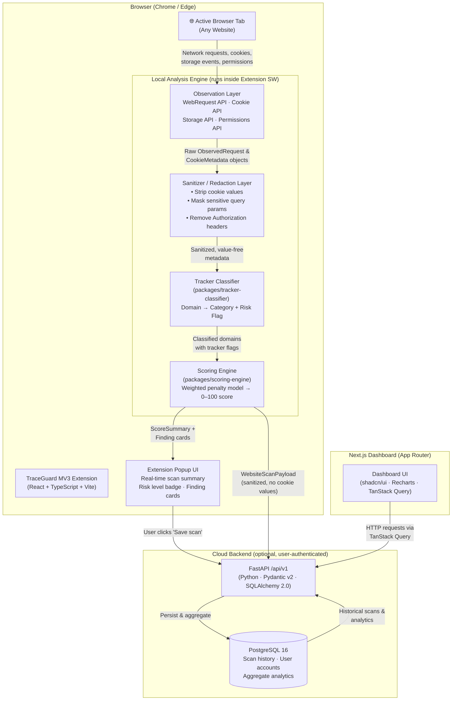
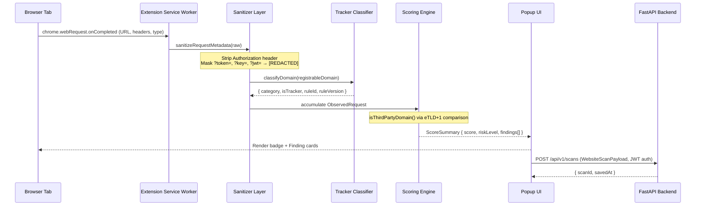
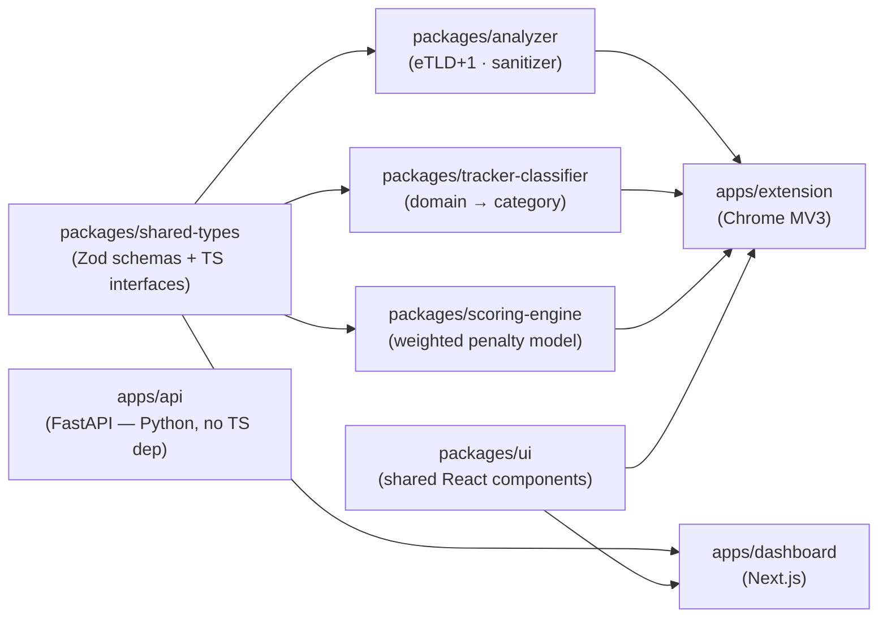

# TraceGuard — System Architecture

> **See what a website does behind the page.**

This document describes the complete technical architecture for TraceGuard: a privacy and security intelligence tool that observes, classifies, scores, and reports on web activity — entirely locally by default, with optional cloud persistence.

---

## High-Level Component Map

---

## Data Flow: Request Lifecycle

---

## Package Dependency Graph

---

## Security & Privacy Boundaries

| Layer | Guarantee |
|---|---|
| Sanitizer | Cookie `.value` is **never stored or forwarded** — metadata (name, domain, flags) only |
| Sanitizer | `Authorization`, `Cookie`, `Set-Cookie` raw header values stripped before any persistence |
| Sanitizer | Sensitive query params (`token`, `auth`, `key`, `secret`, `password`, `session`, `code`, `jwt`) → `[REDACTED]` |
| Scoring Engine | Labels use neutral analytical phrasing — never "SAFE", "UNSAFE", or "malicious" |
| Backend | All scan payloads validated by Pydantic v2 before DB write |
| Auth | Argon2id password hashing; JWT access + refresh token rotation |

---

## Risk Score Bands

| Score | Risk Level | Description |
|---|---|---|
| 90–100 | `MINIMAL` | Minimal observed risk |
| 75–89 | `LOW` | Low observed risk |
| 55–74 | `MODERATE` | Moderate observed risk |
| 35–54 | `ELEVATED` | Elevated observed risk |
| 0–34 | `HIGH` | High observed risk |

---

## Scoring Penalty Model

| Category | Max Penalty |
|---|---|
| Trackers detected | 25 |
| Insecure transport / mixed content | 25 |
| Third-party persistent cookies | 15 |
| Third-party request concentration | 10 |
| Cookie configuration issues | 10 |
| Privacy-sensitive permissions | 10 |
| Storage & other indicators | 5 |
| **Total possible deduction** | **100** |
