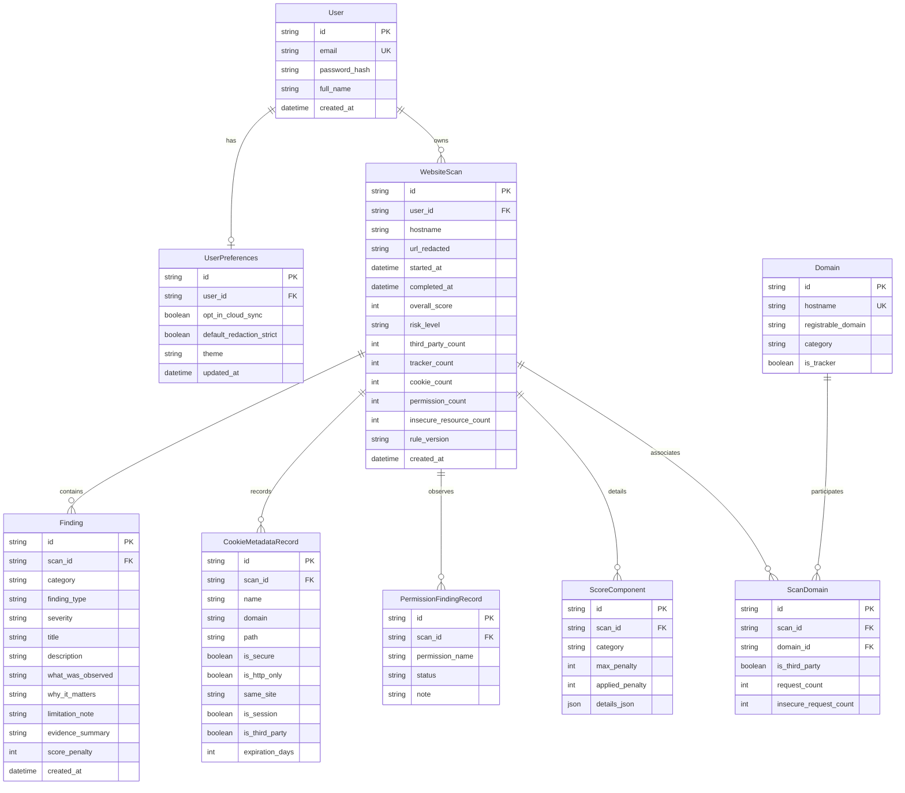

# TraceGuard — Database Architecture & Schema Specification

TraceGuard utilizes an **async-first relational database architecture** supported by **PostgreSQL 16** (production) and **SQLite** (local testing / rapid evaluation). Object-relational mapping is managed by **SQLAlchemy 2.0 (asyncio)** with schema migrations handled by **Alembic**.

---

## 1. Entity-Relationship (ER) Diagram



---

## 2. Table Specifications & Redaction Invariants

### `users` & `user_preferences`
- Manages authenticated auditors with Argon2 password hashes.
- `opt_in_cloud_sync`: When false, the client extension defaults to local-only mode.
- `default_redaction_strict`: Enforces masking on all secret query parameter variants.

### `website_scans`
- Central table storing high-level audit results.
- `overall_score`: Constrained between 0 and 100.
- `risk_level`: Standardized band (`MINIMAL`, `LOW`, `MODERATE`, `ELEVATED`, `HIGH`).
- `url_redacted`: Sanitized page URL with sensitive parameters stripped to `[REDACTED]`.

### `cookie_metadata`
- **Privacy Rule**: The `.value` column is **strictly omitted from the schema definition**. No raw cookie values can be stored in this table under any circumstances.
- Tracks `is_secure`, `is_http_only`, and `same_site` flags for hygiene scoring.

### `findings`
- Stores human-readable finding cards emitted by the scoring engine.
- Every row contains mandatory `what_was_observed`, `why_it_matters`, and `limitation_note` fields.

---

## 3. Alembic Migration & Seeding Workflows

```bash
# Apply migrations to head:
pnpm migrate

# Seed demo data for evaluator testing:
pnpm demo

# Reset database (drops SQLite dev file, re-migrates, and re-seeds):
pnpm reset
```
