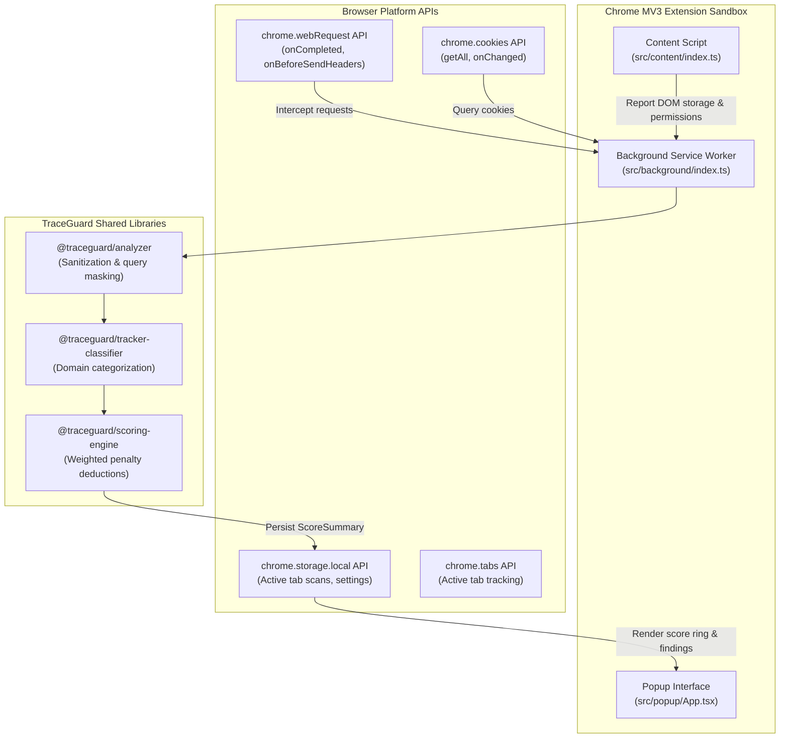

# TraceGuard — Chrome Extension (Manifest V3) Architecture

The TraceGuard browser extension operates as the primary **client-side observation engine**. Built with **TypeScript, React 18, Vite, and Tailwind CSS**, it conforms to the strict Google Chrome Manifest V3 execution model.

---

## 1. Extension Component Architecture



---

## 2. Manifest V3 Declarations & Permissions

Defined in [`apps/extension/manifest.json`](apps/extension/manifest.json):

```json
{
  "manifest_version": 3,
  "name": "TraceGuard — Web Privacy & Security Intelligence",
  "version": "1.0.0",
  "permissions": [
    "webRequest",
    "cookies",
    "storage",
    "tabs",
    "activeTab"
  ],
  "host_permissions": [
    "<all_urls>"
  ],
  "background": {
    "service_worker": "src/background/index.ts",
    "type": "module"
  },
  "action": {
    "default_popup": "popup.html",
    "default_icon": {
      "16": "icons/icon-16.png",
      "48": "icons/icon-48.png",
      "128": "icons/icon-128.png"
    }
  }
}
```

---

## 3. Request Lifecycle & Redaction Flow

1. **`chrome.webRequest.onCompleted`** catches every request completed by the active tab.
2. The raw URL is sanitized:
   ```typescript
   // Replaces ?token=xyz or &key=abc with [REDACTED]
   const cleanUrl = sanitizeUrl(details.url);
   ```
3. Registrable domain (eTLD+1) is parsed:
   - Example: `cdn.analytics.example.co.uk` $\to$ `example.co.uk`.
   - First-party vs Third-party boundary is compared against tab URL.
4. **`classifyDomain(domain)`** evaluates if the host is a known tracker and assigns its category (`Advertising`, `Analytics`, `Session Replay`, `Social Media`).
5. Observation is passed to `@traceguard/scoring-engine` which re-computes the score dynamically.
6. When the popup opens, it reads from `chrome.storage.local` to render the animated **Score Ring**, **Risk Badge**, and detailed **Finding Cards**.

---

## 4. Building & Loading the Extension

```bash
# Compile TypeScript and bundle Vite assets
pnpm --filter @traceguard/extension build
```

To test locally:
1. Navigate to `chrome://extensions/`.
2. Toggle on **Developer mode**.
3. Click **Load unpacked** and select `apps/extension/dist`.
